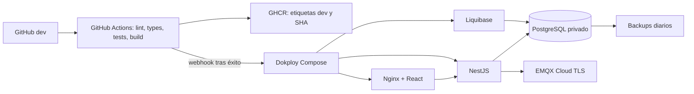

# Arquitectura de despliegue

## Servicios

- Dokploy despliega el Compose de este repositorio, fijado a la rama `dev`.
- PostgreSQL 18 conserva sus datos en un volumen Docker y no publica puertos al host.
- Liquibase ejecuta el changelog antes de que el backend pueda arrancar.
- NestJS se descarga desde GHCR; usa PostgreSQL con roles de aplicación y EMQX Cloud mediante MQTT con TLS.
- Nginx sirve el frontend React/Vite y reenvía `/api/v1/` y Socket.IO al backend dentro de la red privada.
- El contenedor de backup genera dumps diarios en un volumen separado. Ese volumen sigue estando en el VPS; debe copiarse fuera del servidor para disponer de recuperación ante una pérdida del VPS.

El frontend es el único servicio que debe recibir un dominio público en Dokploy. No se declaran `ports` en la composición. Dokploy/Traefik gestiona HTTPS y enruta el dominio al puerto interno 8080.

## Flujo

Los workflows de los tres repositorios solo llaman al webhook después de que sus validaciones pasen. El webhook de Dokploy inicia el Compose central, que vuelve a ejecutar Liquibase antes de comprobar la salud del backend.

## Límites conocidos

- La arquitectura asume un solo servicio Compose con acceso de lectura a GHCR y la red de Dokploy disponible.
- Los nombres de dominio, la IP del proxy de confianza, las credenciales de PostgreSQL, JWT y EMQX deben configurarse en Dokploy.
- Esta configuración no verifica la base existente del VPS. Antes de usarla con datos actuales, hay que confirmar el historial Liquibase y realizar y probar un backup restaurable.
