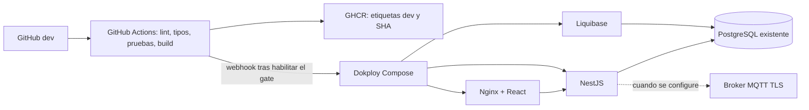

# Arquitectura de despliegue

## Servicios

- Dokploy desplegará el Compose de este repositorio desde `dev` cuando la auditoría y la restauración de prueba estén aprobadas.
- PostgreSQL es la instancia existente del VPS. Este Compose no crea, reinicia ni administra un contenedor de PostgreSQL ni sus volúmenes.
- Liquibase se conecta a la base existente usando el host, la red y una cuenta de migración que se identificarán durante la auditoría.
- NestJS se descarga desde GHCR y usa la instancia PostgreSQL existente con cuentas de aplicacion verificadas. MQTT/TLS y el correo de autenticacion pueden quedar deshabilitados hasta configurar sus servicios externos.
- Nginx sirve el frontend React/Vite y reenvía `/api/v1/` y Socket.IO al backend por una red privada de la aplicación.

El frontend es el único servicio con dominio público en Dokploy. No se declaran puertos publicados; Dokploy/Traefik gestiona HTTPS y enruta el dominio al puerto interno 8080. Los nombres de las redes externas son variables que deben coincidir con las redes encontradas en Dokploy.

## Flujo

Los workflows validan la base con un PostgreSQL 18 desechable solo dentro de GitHub Actions. El job que llamaría a Dokploy permanece deshabilitado hasta verificar el servidor, la configuración de Liquibase y un backup que se haya restaurado correctamente en aislamiento.

## Límites conocidos

- Aún faltan por confirmar el nombre de host de PostgreSQL, la base, el rol de migración, la red que la contiene y la red del proxy de Dokploy.
- Hay que verificar el historial Liquibase y revisar los cambios pendientes contra la base existente antes de retirar el bloqueo del despliegue.
- Los nombres de dominio, secretos de JWT y la direccion del proxy de confianza se configuran en Dokploy despues de la auditoria.

- Con `MQTT_ENABLED=false`, la API omite las conexiones al broker; el control de dispositivos queda inactivo hasta habilitar MQTT TLS.
- Con `EMAIL_ENABLED=false`, el backend arranca sin SMTP; registro, activacion y recuperacion por correo quedan temporalmente no disponibles.
- Los backups deben guardarse fuera del VPS. Este Compose no crea una segunda instancia de PostgreSQL ni un volumen de backup local.
